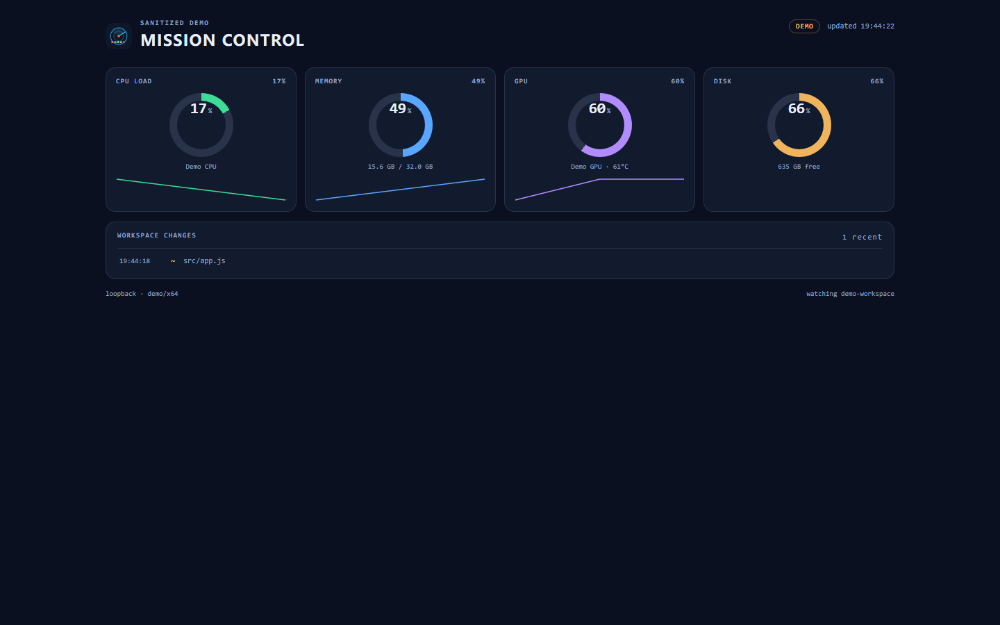
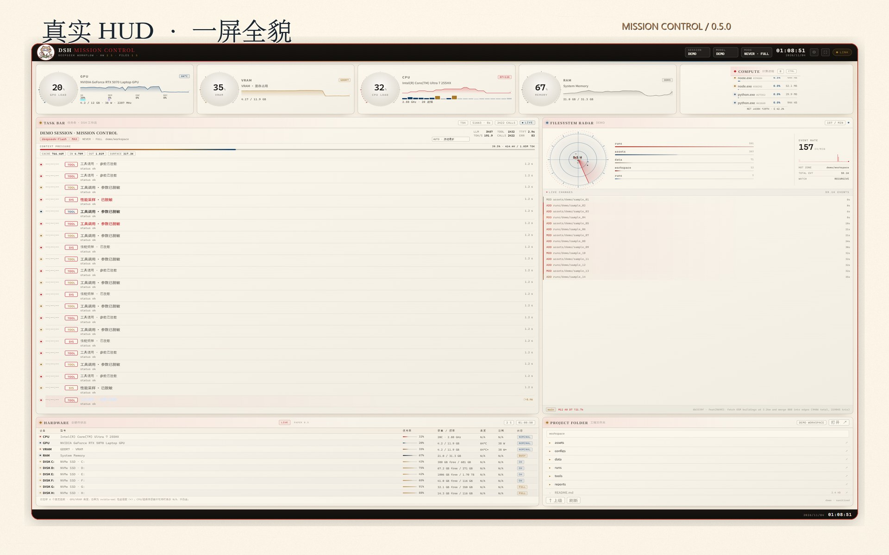

# DSH Mission Control

**Mission Control** is a privacy-first local observability add-on for **DeepSeek
Harness (DSH)**. It runs a loopback-only collector in the DSH Host process and
renders a native React panel in the DSH Web UI right sidebar, with an optional
full-window HUD for deep inspection. All data stays on the machine: there is no
credential, command-line, or remote write endpoint in the compact surface.


*The soldering-cat identity: user-provided artwork, cropped to a transparent PNG.
It is the plugin icon and the full-HUD logo. The owner has confirmed redistribution
permission for this project; see [`NOTICE`](NOTICE). Artwork rights remain with the
provider and are used with permission for this project.*

> Status: **0.5.0 / cat identity + standalone fullscreen**. Compact panel, the
> **FULL** launcher, and the full HUD in a separate fullscreen browser window are implemented.
> The desk pet was removed. No floating summon bar: the bottom dock keeps MC/FULL.
> Re-test in your own DSH profile and in both light/dark themes before release.



*Synthetic, clearly-labelled demo mode (`DEMO`); no real paths, session data, or user identity.*

## Showcase / 宣传片



- [Showcase page](docs/index.html) — 2560×1600 screenshots, install, privacy, agent prompt.
- [Promo package](docs/PROMO.md) — 65 s / 2560×1600 video facts, voice/music provenance.
- [Agent install prompt](docs/AGENT-INSTALL-PROMPT.md) — let another DeepSeek inspect and install.
- Bilibili video: **to be published**; the release asset will be linked here after upload. No BV number is claimed yet.

The promo screenshots are actual HUD frames at 2560×1600, redacted in the DOM
(DEMO session, demo paths, generic folder names). The full local HUD still shows
real session content at runtime; do not screen-share it without checking.

## What it does

- Four live metrics: **CPU / MEMORY / GPU / DISK**.
- Recent **workspace file changes** (relative paths only).
- Host platform/architecture, load average, uptime.
- A native DSH right-sidebar panel opened by **MC**.
- **FULL** starts a separate Chrome/Edge app-mode fullscreen window; no floating
  or in-DSH movable launcher remains.
- The full window: four gauges + COMPUTE, TASK BAR/workflow timeline and session
  picker, filesystem radar + git, HARDWARE matrix, PROJECT FOLDER, 24 themes,
  directory settings, and opt-in process control.
- **No write APIs by default**, no remote access, no credentials. Process control
  and file watching are opt-in; no absolute path is returned by the compact panel.

## Quick start (standalone, no DSH needed)

Requires Node.js **22+** (22/24 tested in CI; no npm dependencies).

```bash
cd <this-repo>
npm start
# open http://127.0.0.1:7799/
```

The demo uses synthetic metrics and shows a **DEMO** badge. To test the same
collector with real local metrics:

```bash
MC_DEMO=0 npm start
```

On Windows PowerShell:

```powershell
$env:MC_DEMO = "0"; npm start
```

## Full dashboard window

The complete HUD lives in `dashboard/`. It is served by the plugin's child
process on **http://127.0.0.1:7800/**. **FULL** asks the Host to launch a separate
Chrome/Edge app-mode window at `/?fullscreen=1` with `--start-fullscreen`; it is
not a DSH tab. The bottom composer dock keeps **MC** and **FULL**; the old
bottom-right summon bar was removed. Use **Esc** to leave fullscreen, **F11** to
toggle, and allow the browser to start if a security prompt appears.

Standalone:

```bash
node dashboard/server.mjs
# open http://127.0.0.1:7800/
```

Full-window contents:

- TASK BAR: DSH workflow, session picker, context/token pressure;
- FILESYSTEM RADAR + git + live change feed;
- full HARDWARE matrix (all fixed disks) with explicit N/A sensor fields;
- one-time first-load hardware benchmark (CPU / memory / sequential disk R/W / NIC link) and a persistent DISK READ / WRITE + NET PEAK / MAX strip;
- per-disk live read speed from raw Windows performance counters; the usage bar is current read / observed MAX, not capacity usage;
- PROJECT FOLDER window with true folder/file listing and one-click open;
- 24 themes (8 groups × 3) and directory settings;
- standalone fullscreen window launched by the Host (Chrome/Edge app mode);
- process control **only if** `MC_ALLOW_PROC=1` / `allowProcessControl: true`.

The 0.5 layout uses a 0.618 / 0.382 split for both the middle and bottom rows.
The full HUD is designed for 1352 / 1600 / 1920 / 2560 / 2660-wide loopback windows.

Privacy behavior:

- `watchDir` empty → the full HUD watches a neutral temporary workspace, not the
  DSH process directory.
- Session workflow text is rendered locally from DSH projections; it is not sent
  anywhere. Do not screen-share the full window if that text is sensitive.
- Process control is off by default; the UI shows READONLY.
- The PAPER budget values are a **generic reference envelope**, not the private
  report numbers. Edit `PAPER` in `dashboard/public/app.js` for your own hardware.

## DSH installation

This directory is a Cordis bundle. Install it once in the DSH profile that has
Full access:

### Via the Plugins page (recommended)

1. DSH Web sidebar → **Plugins** → **Add plugin** → **Install a third-party plugin**.
2. Paste the absolute path to this folder, for example
   `<absolute path to this repo>` (the install dialog accepts a local directory).
3. Confirm the read-back (package name + one-liner) and **Install**.
4. When installation finishes, choose **Enable now**. A new install can activate
   through HMR; replacing an already-installed package requires a DSH restart.
5. Open a conversation → click **MC** for the compact right-sidebar panel, or
   **FULL** in the composer dock for the separate fullscreen HUD window.
6. Verify the collector: `http://127.0.0.1:7799/api/health` and
   `http://127.0.0.1:7799/api/snapshot`.

### Via an agent with Full access

Ask the agent to run `plugin_manager` `install_bundle` with
`target: "<absolute path to this repo>"`, then read the result:
`application: applied` is live; `failed` / `overridden` / `restart-required`
must not be reported as success. Remove with `remove_bundle`.

The default config lives in `cordis.patch.yml`. File watching is **opt-in**: leaving `watchDir` empty keeps metrics-only mode, so the plugin never inspects the DSH process cwd:

```yaml
port: 7799
watchDir: ""          # empty = file watching OFF (metrics only)
pollMs: 2000
enableFileWatch: true
```

The client uses `http://127.0.0.1:7799` by default. If you change `port`, update
the client constant or set `localStorage["dsh-mission-control-api"]` to the new
base URL in the DSH Web UI.

## 中文安装（DSH）

1. 打开 DSH 左侧 **Plugins** → **Add plugin** → **Install a third-party plugin**。
2. 粘贴本仓库的**绝对路径**（例如本机测试目录的完整路径），确认读取到的包名/简介。
3. 点击 **Install**，完成后点 **Enable now**；若之前装过同名包，替换后需要重启 DSH。
4. 打开一个对话，点击输入框上方 composer 区域的 **MC** 打开右侧栏迷你面板，
   点击 **FULL** 单开完整 Mission Control 全屏窗口。
5. 浏览器可访问 `http://127.0.0.1:7799/api/health` 检查采集器。

## Privacy / sanitization

The **static repository** intentionally contains none of the following:

- user names, home directories, absolute workspace paths, hostnames;
- pre-recorded DSH session IDs, prompts, tool command lines, transcript text;
- API keys, gateway URLs, probe records;
- private project names, constraint files, or screenshots;
- always-on process-control or delete endpoints.

Runtime behavior is split:

- **Compact panel** returns no session data and no absolute paths; file events are
  relative to the configured root and are disabled by default.
- **Full HUD** reads local DSH session projections, process lines, and workspace
  events **at runtime** and renders them only in the loopback window. Nothing is
  uploaded. Its default workspace is a neutral temporary directory; session cwd is
  masked to a basename; process control is off unless explicitly enabled.

See [`docs/SANITIZATION.md`](docs/SANITIZATION.md) for the full runtime-surface
audit.

## Repository layout

```text
.
├─ package.json          # DSH bundle manifest + dsh.client
├─ cordis.patch.yml      # profile patch: inserts the host row
├─ index.js              # Host half: starts the loopback collector
├─ client.js             # Web half: right-sidebar tab + composer button
├─ src/
│  ├─ telemetry.mjs      # compact CPU/mem/GPU/disk/file-event collection
│  └─ server.mjs         # compact loopback HTTP + SSE
├─ dashboard/
│  ├─ server.mjs         # full-window HUD server (child process)
│  └─ public/            # full HUD: index/app/style/paper/themes/icon
├─ demo/                 # standalone synthetic compact demo
├─ locale/{en,zh}.json   # plugin metadata
├─ icon.png              # user-provided cat artwork, transparent crop (plugin icon + logo)
├─ docs/                 # DSH integration, architecture, sanitization
└─ scripts/              # syntax/manifest/privacy checks
```

## Development checks

```bash
npm test                 # syntax + manifest + host smoke + client wiring
npm run manifest         # bundle/export/icon/locale validation
npm run check            # JS syntax + privacy scan
```

Before publishing, read [`docs/PUBLISHING.md`](docs/PUBLISHING.md). It covers the
name/scope update, the three places that must stay in lockstep, `npm pack`, and the
one required DSH install test.

## What is intentionally not here yet

- The private mission-replay page and private cross-module contracts were removed
  from the port; the full HUD itself is present.
- A privacy-redacted workflow mode: the full HUD renders local DSH session text.
  A later version can add aggregate-only counters for safe screen sharing.
- Disk read speed uses raw Windows `Win32_PerfRawData_PerfDisk_LogicalDisk` deltas; cached/idle reads can legitimately show `0 B/s`, and `MAX` is the observed peak for the current server session.
- A Host Remote transport; 0.5.0 still uses loopback HTTP + a child process.
- Process control is present but **disabled by default**; enable it explicitly
  with `allowProcessControl: true` in a trusted local environment.
- Per-user auth or remote access. The collector is loopback-only by design.
- A published npm package. This local build uses `dsh-mission-control`; publish
  under your own scope after an install test.

## Roadmap

| Version | Scope |
|---|---|
| 0.5.0 (this repo) | Cat identity + standalone fullscreen HUD (no desk pet) |
| 0.6 | DSH aggregate workflow counters without local transcript text |
| 0.7 | Replace the loopback HTTP/child process with Host Remotes; remove fixed ports/CORS |

## Proof status

- Host collector, demo API, privacy payload, bundle manifest, Client registration
  wiring: **verified locally** by `scripts/check.mjs`, `manifest-check.mjs`,
  `smoke-host.mjs`, and `smoke-client.mjs`.
- DSH install + rendered compact panel: **verified in an isolated sandbox profile**
  (`mc-sandbox`): Host row active, loopback `/api/health` 200, compact panel
  rendered four live metrics with no Mission Control client errors.
- Full-window HUD: **verified in the sandbox and in the actual desktop profile**:
  the **FULL** button opened `http://127.0.0.1:7800/`, and the ported HUD loaded
  gauges, workflow, radar, chart, settings. HMR activated the desktop install
  without a restart; both 7799/7800 health endpoints returned 200.
- Full HUD keeps HARDWARE/PAPER visible and the footer time; the compact lineage
  remains separate.
- The launcher moved from `conversation.session.header.corner` (occupied by a
  host single-slot registration) to `conversation.composer.dock`; details are in
  [`docs/VERIFICATION.md`](docs/VERIFICATION.md).
- Default privacy check: with `watchDir: ""` the compact panel shows **File watch
  disabled**; the full HUD uses a neutral temporary workspace.
- Not verified: the Plugin Manager **UI** install path (the sandbox used the
  equivalent CLI), other DSH versions, and both light/dark themes. Re-test those
  before a stable release.
- The synthetic `docs/demo.png` is generated by demo mode, not by a real session.
  Sandbox panel/full-window screenshots contained local session content, so they
  are kept out of this public repo.

## License

MIT for code and documentation. The cat artwork is user-provided and included
with the owner's permission for this project; see [`NOTICE`](NOTICE). No third-party icon font is bundled. See [`LICENSE`](LICENSE) and
[`CONTRIBUTING.md`](CONTRIBUTING.md).

## Evaluate with your own DeepSeek

Want a second opinion before installing? Copy the prompt in
[`docs/EVALUATE-WITH-DEEPSEEK.md`](docs/EVALUATE-WITH-DEEPSEEK.md) into your
DeepSeek: it will inspect this repo, check fit with your DSH environment, and
give install / verify / rollback steps without auto-installing.

